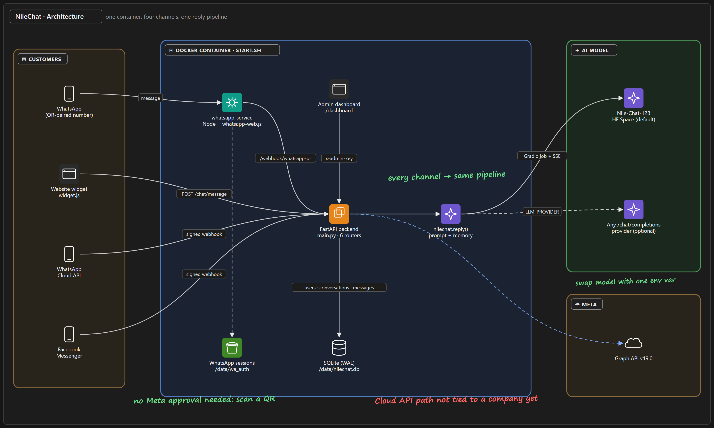
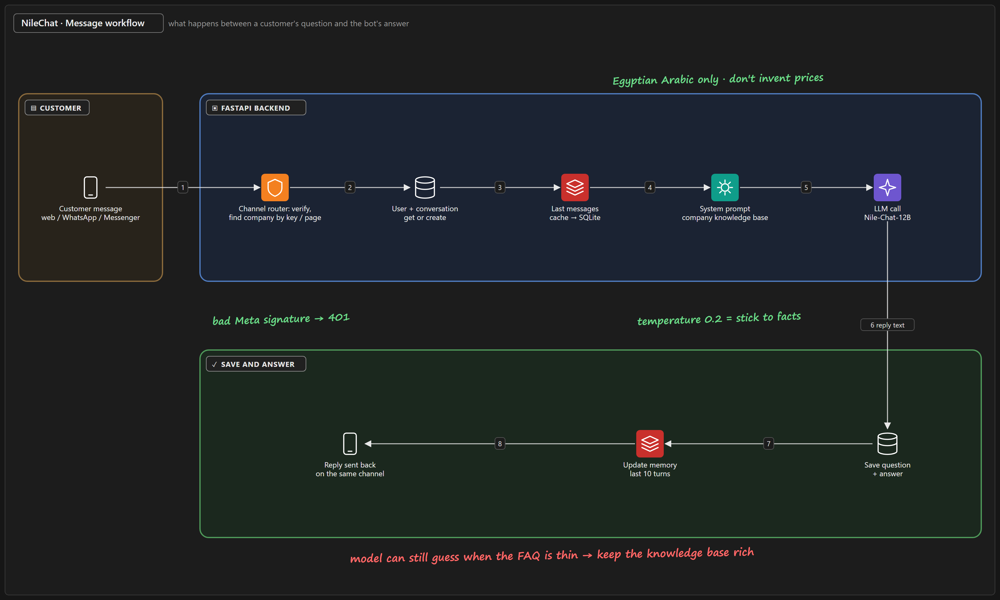
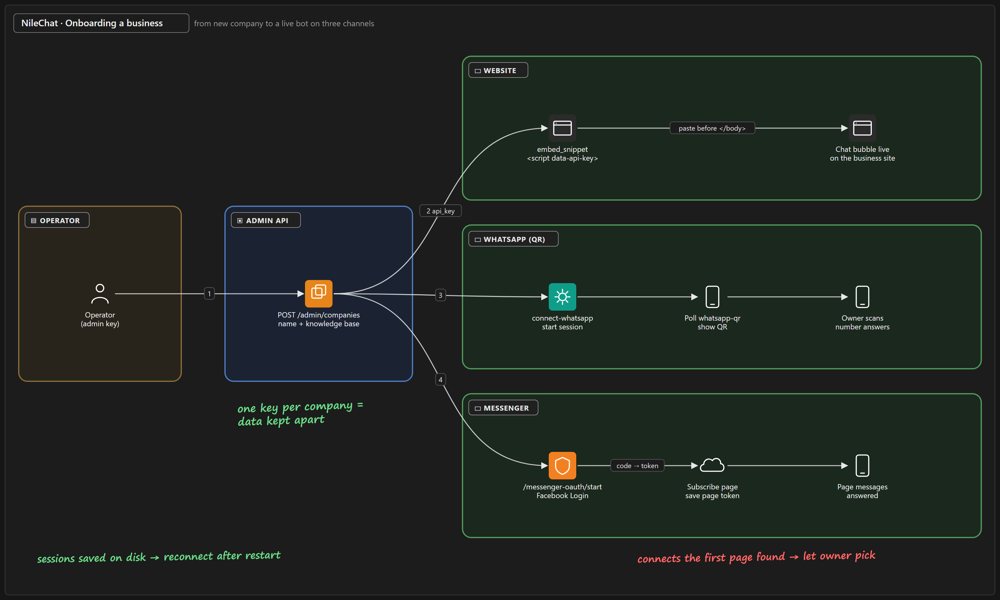

# NileChat

An AI customer-service bot for Egyptian businesses. It answers customers in Egyptian Arabic on the business's website, WhatsApp and Facebook Messenger, using that business's own FAQ, prices and policies.

**Stack:** Python 3.11 · FastAPI · Nile-Chat-12B (Hugging Face Space) · SQLite · Node.js + whatsapp-web.js · Meta Graph API · Docker



---

## The problem

Small businesses in Egypt get most customer questions on WhatsApp and Facebook, in Egyptian dialect, and often after working hours. Most chatbot tools are built for English or Modern Standard Arabic, and connecting to the official WhatsApp API requires Meta business verification, which many small businesses don't have. So questions like "how much is the apartment?" or "do you have parking?" wait hours for a human reply.

## The solution

NileChat runs one backend that serves many businesses ("companies"). Each company gets an API key and stores its knowledge base: products, prices, opening hours, FAQ. A customer message from any channel goes through the same pipeline:

1. Find which company the message belongs to.
2. Load that customer's recent conversation.
3. Build a system prompt from the company's knowledge base.
4. Ask the model, then save the reply and send it back.

The default model is **Nile-Chat-12B** (MBZUAI-Paris), which is trained for Egyptian Arabic. The system prompt tells it to answer only from the company's information, quote prices exactly, and say "I don't have information about that" instead of guessing.

For WhatsApp there are two paths: the **official Cloud API** webhook, and a **QR pairing** service that lets a business connect its existing number by scanning a code, with no Meta approval needed.

## Message workflow



1. A customer writes on the website widget, WhatsApp or Messenger.
2. The channel router checks the request and finds the company:
   - widget: by `api_key`
   - Messenger: by Facebook `page_id`
   - QR WhatsApp: by `company_id` from the Node service
   - Meta webhooks: the signature is checked first
3. The customer and an active conversation are found or created in SQLite.
4. Recent history is loaded from an in-memory cache, or from the last 5 saved messages when the cache is empty.
5. The system prompt is built from the company name and knowledge base.
6. The model is called. For Nile-Chat-12B the backend submits a job to the Space's Gradio API and reads the result from its server-sent event stream.
7. The question and answer are saved, and the memory keeps the last 10 turns.
8. The reply goes back on the same channel.

## Onboarding a business



| Channel | Steps |
|---|---|
| Website | `POST /admin/companies` returns an `api_key` and a ready `<script>` embed snippet; paste it before `</body>` |
| WhatsApp (QR) | `POST /admin/companies/{id}/connect-whatsapp`, poll `GET /admin/companies/{id}/whatsapp-qr`, scan with the business phone |
| Messenger | Send the owner to `/messenger-oauth/start?api_key=...`; after Facebook Login the page is subscribed to the webhook and its token is saved |

The admin dashboard at `/dashboard` wraps these calls.

## Key features

- Multi-company backend: every company has its own API key, knowledge base and welcome message
- Four entry points into one reply pipeline: website widget, WhatsApp QR, WhatsApp Cloud API, Messenger
- Egyptian-Arabic system prompt that stays on the company's facts and prices
- Conversation memory per customer and channel
- Model can be swapped by configuration: Nile-Chat-12B by default, or any `/chat/completions` provider
- Self-serve WhatsApp pairing by QR, with saved sessions that reconnect after a restart
- One-click Messenger connection through Facebook Login
- Ready-made demo client (real-estate agency "عقارات جميلة") with sample listings and a demo site at `/demo`
- Single Docker image running both services, with data on one persistent volume

## Engineering decisions

**One pipeline, many channels.**
Every router ends in `nilechat.reply()`, so prompt rules, memory and storage behave the same on every channel. Adding a channel means writing a router that finds the company and sends the reply. *Trade-off:* channel-specific features (images, buttons) aren't supported yet; the conversation is text only.

**A second WhatsApp path that needs no Meta approval.**
`whatsapp-service/` runs one `whatsapp-web.js` client (headless Chromium) per company and pairs it by QR. Each login is saved under `WA_AUTH_DIR` and restored on startup. *Trade-off:* this uses WhatsApp Web, not the official API, so a dedicated business number is recommended, and every paired number gets automatic replies on all its one-to-one chats (group chats are skipped).

**Calling a model that has no completions API.**
Nile-Chat-12B is served as a Gradio Space. The client warms the Space on the first call, submits a job to `/gradio_api/call/chat`, and reads the last `data:` event from the stream using async `httpx`, so other requests aren't blocked while it waits. Temperature is set to 0.2 to keep answers close to the knowledge base.

**Swappable model.**
`LLM_PROVIDER=chat_completions` with `LLM_BASE_URL`, `LLM_MODEL` and `LLM_API_KEY` sends the same prompt and history to any OpenAI-compatible endpoint, with no code change.

**SQLite instead of a hosted database.**
All data is in one SQLite file in WAL mode, so the web, WhatsApp and admin routes can read while another one writes. Blocking `sqlite3` calls run in a worker thread to keep FastAPI async. The schema is applied automatically on startup. *Trade-off:* this fits one server; several servers would need a shared database.

**Webhook safety.**
WhatsApp (`X-Hub-Signature-256`, SHA-256) and Messenger (`X-Hub-Signature`, SHA-1) payloads are checked with HMAC against the app secret, and invalid signatures get `401`. Processing errors still return `200`, so Meta doesn't keep resending the same message. WhatsApp sends retry up to 3 times, with exponential backoff on `429`.

**Access boundaries.**
Admin and WhatsApp-pairing routes require the `x-admin-key` header. The Node service calls the backend with the same key. The public chat API is open to any website (CORS `*`) because the widget runs on clients' sites, but it only answers for a valid company `api_key`.

## Project structure

```text
main.py               FastAPI app: mounts the 6 routers, serves widget/dashboard/demo, optional ngrok tunnel
nilechat.py           Reply pipeline: memory, system prompt, Nile-Chat Space client, chat-completions client
db.py                 SQLite access layer (async wrappers, schema bootstrap)
schema.sql            companies, users, conversations, messages
admin.py              Company management API + embed snippet
webchat.py            Public widget API (/chat/message, /chat/welcome)
whatsapp.py           WhatsApp Cloud API webhook + sender with retry
whatsapp_qr.py        Bridge to the Node QR service + admin pairing routes
messenger.py          Messenger webhook, finds the company by page ID
messenger_oauth.py    Facebook Login flow to connect a business page
seed_demo.py          Creates/updates the real-estate demo client
whatsapp-service/     Node.js service: one whatsapp-web.js session per company
static/               widget.js, admin dashboard, demo site
docs/                 Setup guides for WhatsApp and Messenger, diagrams
Dockerfile, start.sh  One image running both services
```

## API

| Method | Path | Auth | Purpose |
|---|---|---|---|
| `GET` | `/` | none | Health check |
| `POST` | `/chat/message` | company `api_key` in body | Widget message → bot reply |
| `GET` | `/chat/welcome` | `api_key` query | Company name and welcome message |
| `GET`, `POST` | `/admin/companies` | `x-admin-key` | List / create companies |
| `GET` | `/admin/companies/{id}` | `x-admin-key` | Company details + embed snippet |
| `PUT` | `/admin/companies/{id}/knowledge` | `x-admin-key` | Update knowledge base / welcome message |
| `POST` | `/admin/companies/{id}/connect-whatsapp` | `x-admin-key` | Start QR pairing |
| `GET` | `/admin/companies/{id}/whatsapp-qr` | `x-admin-key` | Get the QR image or status |
| `GET` | `/admin/companies/{id}/whatsapp-status` | `x-admin-key` | Pairing status |
| `POST` | `/admin/companies/{id}/disconnect-whatsapp` | `x-admin-key` | Disconnect a number |
| `GET`, `POST` | `/webhook/whatsapp` | Meta verify token / signature | Cloud API webhook |
| `GET`, `POST` | `/webhook/messenger` | Meta verify token / signature | Messenger webhook |
| `POST` | `/webhook/whatsapp-qr` | `x-admin-key` | Messages from the Node service |
| `GET` | `/messenger-oauth/start`, `/messenger-oauth/callback` | company `api_key` | Facebook Login flow |
| `GET` | `/widget.js`, `/dashboard`, `/demo` | none | Static assets and demo |

## Data model

```text
companies ──< conversations >── users
                  │
                  └──< messages (role: user | bot)
```

- **companies:** name, `api_key`, knowledge base, welcome message, Messenger page ID and token
- **users:** a customer, identified by phone number or by a channel-prefixed ID (`web_<session>`, `messenger_<psid>`, `waqr_<phone>`)
- **conversations:** one active conversation per user, channel and company
- **messages:** the question and answer history

## Getting started

### Prerequisites

- Python 3.11
- Node.js (for the WhatsApp QR service) and Google Chrome or Chromium
- A Hugging Face access token (`HF_API_KEY`) for the Nile-Chat Space

### Run locally

```bash
git clone https://github.com/AmmarMaamoun/nilechat-bot.git
cd nilechat-bot
pip install -r requirements.txt
cd whatsapp-service && npm install && cd ..
cp .env.example .env          # then fill in the values you need
python seed_demo.py           # optional: create the demo client
python main.py                # backend on http://localhost:8000
cd whatsapp-service && node index.js   # QR service on port 3001 (second terminal)
```

Open http://localhost:8000/demo for the demo site with the widget, or http://localhost:8000/dashboard for the admin dashboard.

Meta webhooks need a public HTTPS URL. If `NGROK_AUTHTOKEN` is set and `pyngrok` is installed (`pip install pyngrok`), `python main.py` opens a tunnel and prints the webhook URLs to register with Meta. Step-by-step channel setup is in [docs/whatsapp_setup.md](docs/whatsapp_setup.md) and [docs/messenger_setup.md](docs/messenger_setup.md).

### Run with Docker

```bash
docker build -t nilechat .
docker run -p 8000:8000 --env-file .env -v nilechat-data:/data nilechat
```

`start.sh` creates the demo client, starts the WhatsApp service in the background and runs the API. The `/data` volume holds the SQLite database and every company's WhatsApp login.

### Configuration

The main variables (full list with comments in [`.env.example`](.env.example)):

| Variable | Purpose |
|---|---|
| `HF_API_KEY` | Hugging Face token for the Nile-Chat Space |
| `LLM_PROVIDER`, `LLM_BASE_URL`, `LLM_MODEL`, `LLM_API_KEY` | Optional: use a `/chat/completions` provider instead |
| `ADMIN_API_KEY` | Protects admin routes and the Node → backend bridge |
| `BASE_URL` | Public URL used in embed snippets and the OAuth redirect |
| `DB_PATH` | SQLite file location (default `nilechat.db`) |
| `WHATSAPP_TOKEN`, `WHATSAPP_PHONE_NUMBER_ID`, `WHATSAPP_VERIFY_TOKEN`, `WHATSAPP_APP_SECRET` | WhatsApp Cloud API |
| `MESSENGER_VERIFY_TOKEN`, `MESSENGER_APP_SECRET`, `FB_APP_ID`, `MESSENGER_PAGE_ACCESS_TOKEN` | Messenger and Facebook Login |
| `WA_SERVICE_URL`, `WA_AUTH_DIR`, `CHROME_PATH` | WhatsApp QR service location, session folder and browser path |
| `NGROK_AUTHTOKEN` | Optional dev tunnel |

## Next steps

- **Ground answers in retrieval.** Nile-Chat can still guess when the knowledge base doesn't cover a question. The plan is to embed each company's knowledge base and pass only the most relevant passages to the model, and to keep knowledge bases detailed until then.
- **Link the Cloud API webhook to a company.** WhatsApp Cloud API messages are answered without a company knowledge base today; mapping `phone_number_id` to a company would give them the same grounded answers as the other channels.
- **Automated tests and CI.** Add pytest coverage for the reply pipeline, routers and database layer using a fake model, and run it with linting on every push.
- **Tighter webhook and OAuth security.** Reject webhooks when the app secret is not configured instead of only logging a warning, use a signed one-time `state` in the Messenger OAuth flow, and let the owner choose which page to connect when they manage several.
- **Protect stored tokens.** Encrypt Messenger page tokens at rest and add rate limiting to the public `/chat/message` endpoint.
- **Hosting.** Deploy the Docker image to a server with a persistent volume and an HTTPS domain, replacing the ngrok tunnel used in development.
- **Per-business dashboard login.** Replace the single shared admin key with accounts so each business can edit only its own knowledge base.
